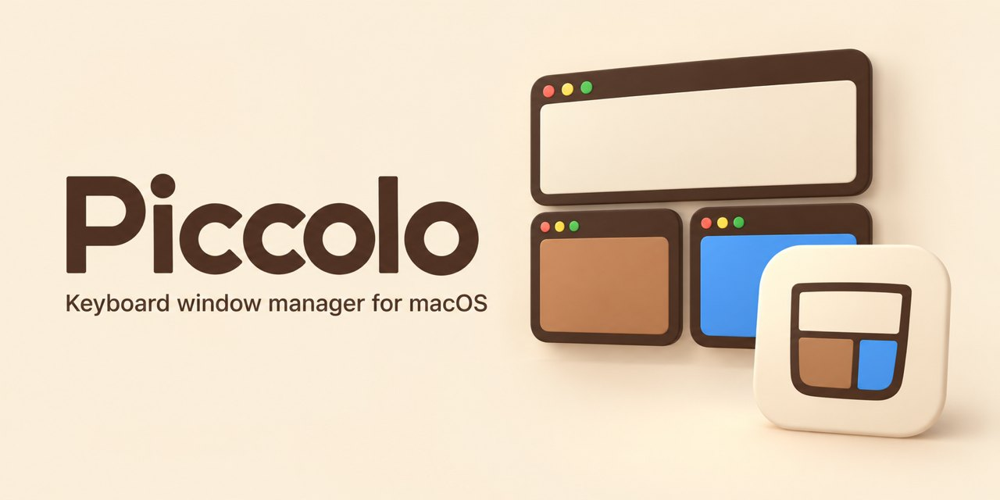
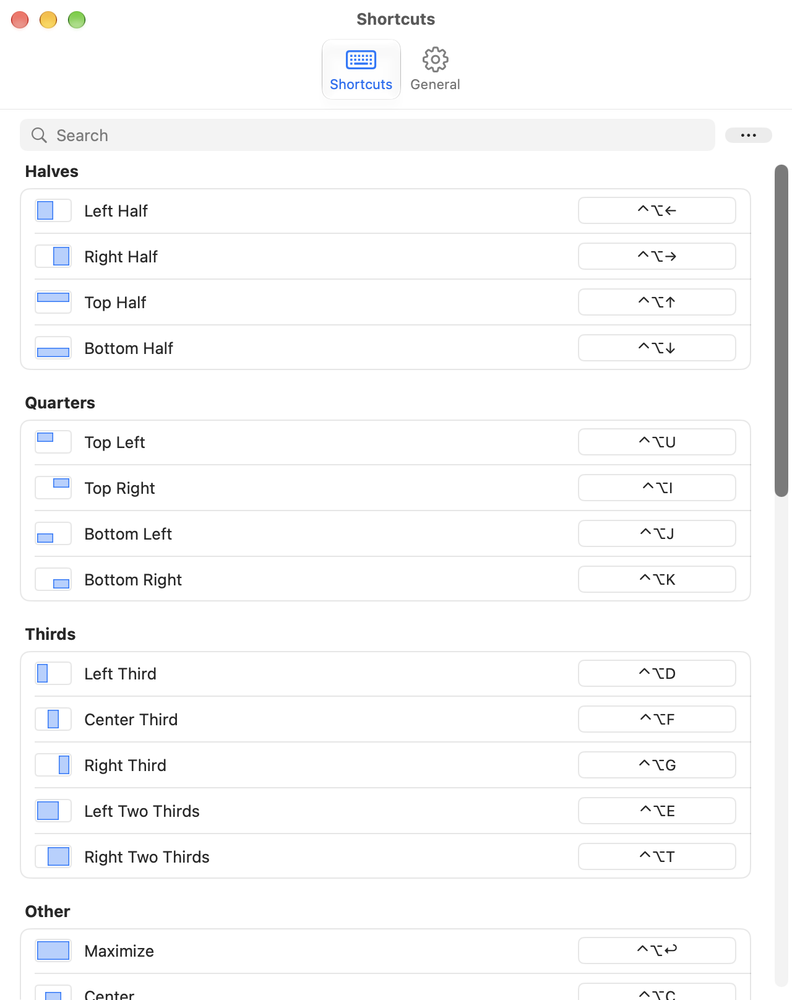
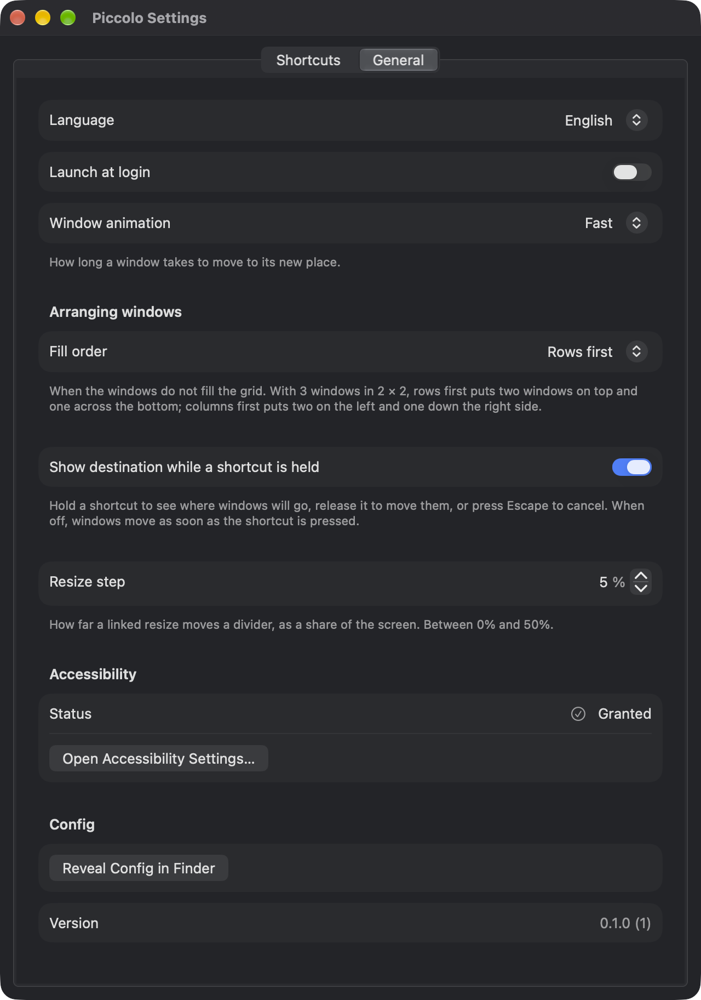

# Piccolo

[](https://github.com/nervouna/piccolo/releases)

[](LICENSE)



Piccolo is a macOS menu bar app that moves, resizes and arranges windows with global keyboard shortcuts. You bind each shortcut to one action in the Settings window, such as placing the focused window at a preset or custom frame, moving it to another display, or arranging your most recently focused windows in a grid; the bindings live in a JSON file you can also edit by hand.




## Status

Piccolo is a personal project, shared for anyone who wants keyboard window management on macOS. It is an alpha: version 0.1.0 is not final, and settings or shortcuts may still change between builds. It needs macOS 14 or later and the Accessibility permission, and nothing else: no account, no network. Alpha builds, signed with a Developer ID and notarized by Apple, are attached to the repository's [releases](https://github.com/nervouna/piccolo/releases) as pre-releases.

What works:

- Placing the focused window at a preset or a custom frame.
- Moving the focused window to the next or previous display, or to the display on its left, right, above or below.
- Arranging the most recently focused windows in a grid.
- Linked resize: after Arrange Grid, Move Divider moves a divider and the neighbouring windows follow, with no gap and no overlap (see [Move Divider](#move-divider)).
- Swap Window: in a group that Arrange Grid placed, the focused window trades places with its neighbour on the side of the key (see [Swap Window](#swap-window)).
- A preview while you hold a shortcut: a highlight shows where the windows will go (see [Destination preview](#destination-preview)).
- The Settings window, for editing bindings and recording shortcuts.
- Launching at login.

## How it is built

Most of the code is written by Claude Code agents. The owner files issues and makes product decisions; Claude writes each issue as a spec, subagents implement it as a pull request, and Claude reviews, runs the acceptance tests, merges and releases. [CLAUDE.md](CLAUDE.md) holds the product scope, the architecture and the rules the agents follow. See [CONTRIBUTING.md](CONTRIBUTING.md) to report a bug or send a fix, and [SECURITY.md](SECURITY.md) for security problems.

## Requirements

- macOS 14 or later.
- The Accessibility permission. Piccolo moves other apps' windows through the Accessibility API. Without the permission, shortcuts still fire, but no window moves. Grant it under System Settings, Privacy & Security, Accessibility. When Piccolo starts without the permission, it asks macOS to show the prompt. It checks for the grant every second until it has it, so you do not need to restart Piccolo. The menu and the General tab show whether it is granted.
- Piccolo is not sandboxed and is not distributed through the Mac App Store. The project's design rules out the sandbox because of the Accessibility API, and the App Store because of the private `_AXUIElementGetWindow` function that matches windows to their numbers (see [CLAUDE.md](CLAUDE.md)).

## Install

From a release archive (download it from the repository's [releases](https://github.com/nervouna/piccolo/releases)):

1. Unzip the archive and move `Piccolo.app` to `/Applications`.
2. Open Piccolo. It has no Dock icon and no Settings window at launch. Its icon appears in the menu bar.
3. Grant the Accessibility permission when asked (see [Requirements](#requirements)).
4. On the first launch Piccolo writes the [default shortcuts](#default-shortcuts) to its config file and shows a short guide: grant Accessibility, move a window with a shortcut, arrange two windows. Every step can be skipped, and the guide can be opened again from the menu with Getting Started…. Open Settings from the menu to change the shortcuts.

From source, `scripts/install.sh` builds the release configuration, replaces `/Applications/Piccolo.app` and opens it. It needs a signing identity. Without one, run `scripts/build.sh` and open `build/Piccolo.app`, then grant it the Accessibility permission. The details are under [Building and testing](#building-and-testing).

## Using Piccolo

Piccolo shows a menu bar icon and no Dock icon. Its menu shows, from top to bottom:

- the Accessibility status, with a button to open its settings when the permission is missing;
- a summary of the shortcuts, such as "3 shortcuts active", followed by the number of config problems when there are any;
- Reload Config, which reads the config file again;
- Reveal Config in Finder;
- Getting Started…, which opens the guide for the first minute with Piccolo;
- Settings… (⌘,);
- Quit Piccolo (⌘Q).

Settings opens from the menu. It also opens when you launch Piccolo again while it is running, for example from Finder or with `open /Applications/Piccolo.app`. It does not open at launch.

Every change you make in the Settings window can be undone with ⌘Z and redone with ⇧⌘Z, except Launch at login and Language, which macOS keeps.

The guide is a small floating panel in the top-right corner of the display with the mouse. It does not take the focus, so the shortcuts it asks you to press act on the window you were working in. Closing it, Skip Guide and Finish all count as seen, and it is shown at launch only on a first launch that was never finished or skipped.

### Shortcuts tab

- **The keymap.** The tab is a keymap: grouped cards, each with a header and a row per action, in the order Halves, Quarters, Thirds, Other, Displays, Arrange Grid, Move Divider, Swap Window and Custom Areas. Every built-in action (the presets, Restore Window, the display moves, Move Divider and Swap Window) has its row whether it has a shortcut or not, once each; only its shortcut can be changed. Arrange Grid has a row for each grid and Custom Areas for each custom area, with a pencil that edits it and an "Add Grid…" or "Add Custom Area…" row at the end of the card.
- **Rows.** A row shows a small picture of the action (the frame or the grid cells on a small screen; an arrow for the display moves; two halves with an arrow for Move Divider and Swap Window; a dashed frame with a turning arrow for Restore Window), its name, and the shortcut button on the right.
- **Search.** The field at the top keeps the rows whose name or shortcut contains what you type, ignoring case and accents, for example `left` or `⌃⌥←`. Cards left empty are hidden, and "No shortcuts match" shows when nothing fits. Escape or the clear button empties the field. The search is not saved.
- **The ⋯ menu** next to the search field has Restore Default Shortcuts… and Reveal Config in Finder. Restore Default Shortcuts… replaces every binding with the [default shortcuts](#default-shortcuts) after you confirm. The linked resize step, the window animation, the window gap, the arranging order and the destination preview stay. A copy of the config file is kept next to it first.
- **Problems.** When the config file has problems, a banner under the search field lists them. A warning sign before a shortcut button means the shortcut is not active, because macOS refused it or Piccolo cannot register it; the banner says why. While you record a shortcut every shortcut is off, and no row is marked.
- **Recording a shortcut.** Click the button on the right of a row. It reads "Record Shortcut" with a dashed border when the row has none, and shows the shortcut, such as ⌃⌥F13, when it has one. Click it, then press the keys: the button reads "Type shortcut…". Press Escape, or click the button again or anywhere else, to cancel. Press Delete or Forward Delete on its own to clear the shortcut. Move the pointer over a shortcut and click the ✕ in the button to clear it.
- **Rules.** A shortcut needs ⌘, ⌥ or ⌃, or it must be a function key (F1 to F20). Shift on its own does not count, so ⇧A is refused. A refused shortcut shows the reason under the row and recording goes on, so press the keys again. A shortcut that another row already has shows a box under the row, for example "⌃⌥← is already used by Left Half.", with Cancel and Replace. Replace moves the shortcut to this row in one step, and the other row is left without it.
- **Hand-edited files.** A config file can bind one built-in action more than once. All of those shortcuts work; the row shows the extra ones as small tags before the button, each with a ✕ that removes that binding. Settings offers no way to add a second shortcut to a row.
- **Saving.** Every accepted change is written to the config file straight away. There is no save button.
- **While recording.** Every global shortcut is switched off, so you can press a shortcut that already exists to record it again. The Settings window takes the key press itself, so keys such as ⌘Q and ⌘, can be recorded.

### General tab



- **Language** is the language of Piccolo's menu and Settings window: System default or one of the [supported languages](#languages). A change applies after Piccolo restarts, which the Restart Now button under the picker does.
- **Launch at login** starts Piccolo when you log in. When macOS is waiting for you to allow it, the tab says so and offers a button to open Login Items in System Settings.
- **Moving windows: Window animation** is how long a window takes to move to its new place, as a segmented control: Off, Fast (0.15 s, the default), Medium (0.25 s) or Slow (0.4 s). It applies to every action, including Arrange Grid, Move Divider and Swap Window.
- **Window gap** is the space, in points, that Piccolo leaves between the windows it places side by side and between those windows and the edges of the visible frame. The default is 0, which changes nothing. Whole numbers from 0 to 64 are accepted, typed or with the arrows; any other value is refused, and the message shows under the field. See [Window gap](#window-gap).
- **Arranging windows: Fill order** decides where the windows go when they do not fill the grid. Two pictures show the choice: with 3 windows in a 2 × 2 grid, Rows first (the default) puts two windows on top and one across the bottom; Columns first puts two on the left and one down the right side.
- **Show destination while a shortcut is held** shows where the windows will go while you hold a shortcut. Release it to move them, or press Escape to cancel. The default is on. When it is off, windows move as soon as the shortcut is pressed.
- **Linked resize step** is how far each Move Divider key press moves a divider, as a share of the display's visible width or height (see [Move Divider](#move-divider)). The default is 5%. Typed values above 0% up to 50% are accepted; any other value is refused, and the message shows under the field. The arrows change it in steps of 1%, between 1% and 50%.
- **Accessibility** shows whether Piccolo has the permission (Granted), or Not granted with a button that opens its settings. The card with Accessibility and Config file is tinted while the permission is missing.
- **Config file** has a Show in Finder button that reveals the config file in Finder.

Under the groups the tab shows Piccolo with its version and build number.

### Destination preview

Hold a shortcut and Piccolo shows where the windows will go: a highlight in your accent colour, one rectangle for the window of a placement or a move to another display, one for each window of an arrangement, one for each window of a divider move, and one for each of the two windows of a swap (at the cell it would move into). Release the shortcut and the windows move there. Press Escape while you still hold it to cancel: nothing moves, and the Escape does not reach the app in front.

A short tap, released within about 0.2 s, shows no highlight and runs the action when you release. The highlight never takes the focus away from the window you are working in, and it also shows over full-screen apps.

When Piccolo cannot work out where the windows would go, for example because no window has the focus, no highlight shows, and releasing the shortcut does what it would do without the preview.

While you hold a shortcut, Piccolo also takes Escape with the same modifiers, so that Escape can cancel it. If the shortcut is itself on Escape, or another app already has that Escape shortcut, Escape cannot cancel it; the preview still works.

To turn the preview off, switch off **Show destination while a shortcut is held** in the General tab, or set `"destinationPreview": false` in the [config file](#config-file). Windows then move as soon as you press the shortcut, with no highlight.

### Failure notice

When a shortcut fires and nothing can happen, Piccolo says why: a short notice in the middle of the display that holds the focused window (or the display with the mouse when no window has the focus), for about a second. It appears when Accessibility is not granted, when no window is there to act on or Piccolo's own window is in front, when the window cannot be moved or resized, when there is no display in that direction, when Restore Window has nothing to restore, when there are no windows to arrange or the grid does not fit the display, and when a divider cannot move or a window cannot swap: the window is not in an arrangement made by Piccolo, the arrangement was changed since (arrange again), the divider cannot go further, or there is no window to swap with in that direction. A placement that changes nothing, a press that cycles a half, and a run that worked, show nothing.

The notice never takes the focus away from the window you are working in, and it also shows over full-screen apps. It is in the language of the interface. There is no setting to turn it off.

### Languages

Piccolo's menu and Settings window are available in English, Simplified Chinese (简体中文), Traditional Chinese (繁體中文), Japanese (日本語), French (Français), Spanish (Español), Brazilian Portuguese (Português (Brasil)) and German (Deutsch). All eight are translated.

By default Piccolo follows the language list of macOS (System Settings, General, Language & Region): the first language of the list that Piccolo is available in. To use another language, open Settings, go to the General tab and choose it under Language. The choice applies after Piccolo restarts: a line under the picker says so, and Restart Now quits Piccolo and starts it again. System default goes back to following macOS.

The choice is stored as Piccolo's own language, which is the same setting System Settings changes under Language & Region, Applications, so changing it in either place changes the other. The config file does not hold it. The list of config problems in the Settings window and the log are in English whatever the language.

## Actions

Each binding runs one action. The windows glide to their new frames over the time set by [Window animation](#general-tab) (0.15 s by default) and end up where they would without it.

| Action | Parameters | What it does |
|---|---|---|
| Place Window (`placeWindow`) | `frame`: a preset, or a custom frame | Sets the frame of the focused window. |
| Restore Window (`restoreWindow`) | none | Puts the focused window back where it was before Piccolo moved it. See [Restore Window](#restore-window). |
| Move to Display (`moveToDisplay`) | `direction`: `next`, `previous`, `left`, `right`, `up` or `down` | Moves the focused window to the neighbouring display and keeps its relative frame. |
| Arrange Grid (`arrangeGrid`) | `count`, `rows`, `columns` | Arranges the `count` most recently focused windows in a grid of `rows` by `columns` cells. |
| Move Divider (`moveDivider`) | `direction`: `left`, `right`, `up` or `down` | Moves a divider between windows that Arrange Grid placed by one resize step, and the neighbouring windows follow. Does nothing for a window that is in no such group. |
| Swap Window (`swapWindow`) | `direction`: `left`, `right`, `up` or `down` | Exchanges the focused window with its neighbour on that side in a group that Arrange Grid placed: the two windows trade cells. With no window on that side the focused window bounces towards that side and back, or, with window animation Off, shows a notice. Does nothing for a window that is in no such group. |

### Place Window

The frame is worked out against the visible frame of the display that holds most of the window. The visible frame is the screen without the menu bar and the Dock.

A custom frame is four fractions of that visible frame. `x` and `y` give the top-left corner and `width` and `height` the size. `width` and `height` must be above 0, and `x + width` and `y + height` must not be more than 1. In Settings the four fields are percentages: Left, Top, Width and Height.

Presets:

| Preset (file name) | Name in Settings | `x`, `y`, `width`, `height` (fractions of the visible frame) |
|---|---|---|
| `leftHalf` | Left Half | 0, 0, 1/2, 1 |
| `rightHalf` | Right Half | 1/2, 0, 1/2, 1 |
| `topHalf` | Top Half | 0, 0, 1, 1/2 |
| `bottomHalf` | Bottom Half | 0, 1/2, 1, 1/2 |
| `topLeft` | Top Left | 0, 0, 1/2, 1/2 |
| `topRight` | Top Right | 1/2, 0, 1/2, 1/2 |
| `bottomLeft` | Bottom Left | 0, 1/2, 1/2, 1/2 |
| `bottomRight` | Bottom Right | 1/2, 1/2, 1/2, 1/2 |
| `leftThird` | Left Third | 0, 0, 1/3, 1 |
| `centerThird` | Center Third | 1/3, 0, 1/3, 1 |
| `rightThird` | Right Third | 2/3, 0, 1/3, 1 |
| `leftTwoThirds` | Left Two Thirds | 0, 0, 2/3, 1 |
| `rightTwoThirds` | Right Two Thirds | 1/3, 0, 2/3, 1 |
| `maximize` | Maximize | 0, 0, 1, 1 |
| `center` | Center | No fixed fraction: keeps the window's size, capped to the visible frame, and centres it |

#### Window gap

With a window gap above 0 (General tab, or `gap` in the [config file](#config-file)), every frame that Piccolo places a window at leaves that many points between windows and to the screen edges, for presets, custom frames, the steps of pressing a half again, the cells of Arrange Grid and the cells that Move Divider and Swap Window move windows to. Each frame is worked out without the gap first, then every edge moves inwards: an edge on the edge of the visible frame by the gap, any other edge by half of it. Two windows side by side are therefore a gap apart, and a window is a gap from each screen edge it touches. With a gap of 12, Left Half is 12 pt from the left, top and bottom edges and ends 6 pt before the middle of the visible frame, and Maximize is 12 pt from every edge.

- **Odd gaps.** Frames stay on whole points. With an odd gap the two halves of the space between neighbours differ by one point (a left or top edge moves in by the larger half), so the neighbours are still exactly the gap apart.
- **Center** keeps the window's size, capped to the visible frame taken in by the gap on every side.
- **Pressing a half again** compares the window with the gapped steps, so cycling works as without a gap.
- **Arrange Grid, Move Divider and Swap Window.** The cells are gapped, a divider move keeps the gap between the windows that follow it, and swapped windows take the gapped cells of each other. A group uses the gap that is in effect when the key is pressed: windows arranged with one gap and moved after the gap changed are moved with the new gap, and the group is still recognised.
- **Move to Display** keeps the window's relative frame measured against each display's visible frame taken in by the gap on every side, so a gapped half on one display becomes a gapped half on the other (exactly so when the displays have the same size).
- **Restore Window** puts the window back at its recorded frame, without a gap.
- A cell of Arrange Grid that the gap makes less than 100 pt wide or high is refused, like any other cell that small.

#### Pressing a half again

Left Half, Right Half, Top Half and Bottom Half cycle. The first press places the window at half of the visible frame, the same shortcut pressed again makes it 2/3 and then 1/3 of the width (the height for Top Half and Bottom Half), anchored to the same edge, and one more press goes back to 1/2. A press counts as the next step when the window is still at the step the previous press placed it at, within 2 pt on every edge, or at the frame it ended at when it refused the exact size. In any other case the press places the window at 1/2. The other presets and custom frames do not cycle. The destination preview shows the next step, and `action.run` cycles too.

### Restore Window

Restore Window puts the focused window back where it was before Piccolo moved it, with the animation of the other actions. Piccolo remembers, for every window it changed, the frame the window had before (its origin) and the frame it ended at. This covers Place Window, Move to Display, every window of an arrangement and every window a divider move or a swap changed.

- **One level.** Only the frame before Piccolo's first change since you last moved the window yourself is kept. A restore forgets the window, so a second press has nothing to restore.
- **After you moved it.** When you move or resize a window by hand after Piccolo placed it, the record is replaced: Restore Window then has nothing to restore, and the next Piccolo action takes the frame you left as the new origin.
- **A display that is gone.** When the origin is on no display any more, the window is centred, at its size, on the display it is on now.
- **Nothing to restore.** Piccolo shows the notice "Nothing to restore" and the window stays.
- **Memory.** The records are kept in memory only and are gone when Piccolo quits. A window without a window number is not remembered.

### Move to Display

Displays are ordered from left to right by the left edge of their frame. Displays with the same left edge are ordered from top to bottom. `next` moves the window to the display after its current one in this order, and `previous` to the one before. Both wrap around, so with two displays both directions lead to the other display.

`left`, `right`, `up` and `down` pick a display by its place on the screen instead. For `left`, the candidates are the displays that lie entirely to the left of the current one. Among them, a display whose height overlaps the current one's wins, the largest overlap first; when none overlaps, the nearest one wins. `right`, `up` and `down` work the same way. These directions do not wrap around: when no display lies that way, nothing happens.

The window keeps its position and its size as fractions of the visible frame of its display. A window larger than the visible frame of the target display is capped to it, and the window is moved back inside that visible frame. With one display, nothing happens.

### Arrange Grid

Arrange Grid takes the `count` most recently focused windows and places them in `rows` by `columns` cells.

- **Which windows.** Only windows that are on screen in the current Space are used, on the display that holds the focused window. Without a focused window, the display of the frontmost window is used. Only standard windows are used, not panels, sheets or other auxiliary windows. Minimized and full-screen windows are left out, and so are the windows of an application that does not answer quickly. Piccolo's own windows are never arranged.
- **Order.** The focused window counts as the most recently focused. Piccolo knows the focus order only since it started. Windows it has not seen focused come after the others, in front-to-back order.
- **Cells.** The most recently focused window takes the top-left cell. The others fill the cells row by row, from left to right and from top to bottom; with Columns first (General tab, or `gridFillOrder` in the config file) they fill column by column instead, from top to bottom and then from left to right, and Move Divider works on such a group with Left and Right moving the divider between the columns. The cell edges are whole points, and neighbouring cells share their edges.
- **Fewer windows than cells.** The grid is laid out for the windows there are. The cells fill row by row, a last row that is not full stretches across the width, and the rows share the height. Three windows in a 2 × 2 grid give two cells side by side on top and one across the bottom.
- **Cells too small.** If any cell would be less than 100 pt wide or high, nothing is moved, and the reason goes to the log.
- **Failures.** A window that cannot be moved, for example because it was closed in the meantime, does not stop the others. Arranged windows are moved, not raised or focused.

### Move Divider

Move Divider works on windows that Arrange Grid placed, and only on those. After an arrangement, its windows form a group: side by side, stacked or in a grid. The key acts on the group that holds the focused window. When the focused window is in no group, nothing happens. Windows that you placed one by one, for example with Left Half and then Right Half, never form a group.

- **Which divider moves.** The key moves the edge of the focused window that faces the direction of the key, and the divider travels in that direction. When that edge is the edge of the display, the opposite edge moves instead. With three windows side by side, A | B | C, Left from A moves the divider between A and B to the left (A gets narrower, B wider), and Right from B moves the divider between B and C to the right (B grows). With two windows there is one divider, and both windows move it the same way. Up and Down do the same for the dividers between rows. A window in the middle can only grow with its own keys; to make it smaller, press a key from its neighbour.
- **Aligned dividers.** In a grid, vertical dividers that line up move together, so that a 2 × 2 grid stays a 2 × 2 grid. A row whose dividers do not line up with the moved one is not affected: with three windows in 2 × 2, the wide bottom window does not move when the divider between the two top windows does. The divider between rows runs across the whole width.
- **Step.** Each press moves the divider by the linked resize step (General tab, default 5%) of the display's visible width or height.
- **Limit.** No window gets narrower or lower than 10% of the display's visible width or height. A press that would cross the limit moves the divider as far as the limit allows, and at the limit the key does nothing.
- **Windows that refuse a size.** A window may not accept the size it is asked for, for example because of a minimum size, or because a terminal resizes by character cell. The divider then stops where that window ended up, and its neighbour fills the space, so there is still no gap or overlap.
- **Order.** The windows that get smaller are resized first and those that grow after, so that no window covers another while the divider moves.
- **When a group dissolves.** There is one group per display, and arranging again on a display replaces its group. Groups are kept in memory only and are gone when Piccolo quits. A group is checked when you press a Move Divider key: when a window of the group has been closed, minimized or has left the screen, or an edge of one is more than 2 pt from where Piccolo left it (you moved or resized it), the group is dissolved and that press does nothing. Arrange the windows again to make a new group.

### Swap Window

Swap Window works on windows that Arrange Grid placed, like Move Divider, and only on those. The key acts on the group that holds the focused window: the focused window and its neighbour on the side of the key trade places. When the focused window is in no group, nothing happens.

- **Which neighbour.** Left, Right, Up and Down pick the window next to the focused one on that side. When several windows border that side, for example three windows in 2 × 2 with the wide bottom window going Up, the one that shares the longest stretch of the edge wins, and on a tie the one that comes first in the order of the cells (row by row, or column by column with Columns first). Windows are never skipped over, and nothing wraps around: with no window on that side nothing happens.
- **Sizes stay with the cells.** The layout does not change. Each window takes the size of the cell it moves into: in `[A 60% | B 40%]` swapping gives `[B 60% | A 40%]`. The other windows of the group do not move, the group stays linked, and Move Divider keeps working on it.
- **The focus stays.** The focused window keeps the focus and moves with its new cell, and no window is raised, so pressing the same key again carries it on across the group.
- **Windows that refuse a size.** A window that cannot take the size of its new cell ends up at the size it accepts, the divider is recorded where the window ended up, and its neighbours fill the rest, as for Move Divider.
- **Order and animation.** The two windows glide together over the [window animation](#general-tab), and pass each other on the way, so they overlap while they move. The one that gets smaller is then placed first.
- **At the edge.** When there is no window on that side, the focused window bounces instead: it moves 16 pt towards that side, springs back past its start by about 2 pt and settles, in 0.42 s whatever the speed of the [window animation](#general-tab), and ends exactly where it was. Up squashes the window instead of moving it: the top edge stays and the bottom edge comes up by 16 pt, and on the overshoot the window is 2 pt taller than before, because macOS keeps windows below the menu bar. Nothing else changes, and the group stays as it is. With window animation Off there is no bounce and the notice "No window in that direction" shows. The notice shows too when the window cannot bounce: Up on a window whose height cannot be set, or a window that does not answer.
- **When it does nothing.** A window that is in no group, or a group that was dissolved because a window of it was closed or moved (more than 2 pt from where Piccolo left it), shows the same notices as Move Divider.

## Default shortcuts

Piccolo starts with these shortcuts, so the window actions work right after installation. At launch, when there is no config file, Piccolo writes them to `~/Library/Application Support/Piccolo/config.json` and loads them. It never writes over an existing file, also not one with no bindings. Deleting the file brings the defaults back at the next launch. To restore them at any time, choose Restore Default Shortcuts… on the Shortcuts tab of Settings. Restoring replaces every binding and keeps the linked resize step. When there is a config file, a copy of it is kept next to it first, as `config.backup-<yyyyMMdd-HHmmss>.json`.

| Action | Shortcut |
|---|---|
| Left Half | ⌃⌥← |
| Right Half | ⌃⌥→ |
| Top Half | ⌃⌥↑ |
| Bottom Half | ⌃⌥↓ |
| Top Left | ⌃⌥U |
| Top Right | ⌃⌥I |
| Bottom Left | ⌃⌥J |
| Bottom Right | ⌃⌥K |
| Left Third | ⌃⌥D |
| Center Third | ⌃⌥F |
| Right Third | ⌃⌥G |
| Left Two Thirds | ⌃⌥E |
| Right Two Thirds | ⌃⌥T |
| Maximize | ⌃⌥↩ |
| Center | ⌃⌥C |
| Restore Window | ⌃⌥⌫ |
| Display to the Left | ⌃⌥⌘← |
| Display to the Right | ⌃⌥⌘→ |
| Display Above | ⌃⌥⌘↑ |
| Display Below | ⌃⌥⌘↓ |
| Arrange 2 in 1 × 2 | ⌃⌥⇧2 |
| Arrange 3 in 1 × 3 | ⌃⌥⇧3 |
| Arrange 4 in 2 × 2 | ⌃⌥⇧4 |
| Arrange 6 in 2 × 3 | ⌃⌥⇧6 |
| Move Divider Left | ⌃⌥⇧← |
| Move Divider Right | ⌃⌥⇧→ |
| Move Divider Up | ⌃⌥⇧↑ |
| Move Divider Down | ⌃⌥⇧↓ |
| Swap Window Left | ⌃⌥⇧⌘← |
| Swap Window Right | ⌃⌥⇧⌘→ |
| Swap Window Up | ⌃⌥⇧⌘↑ |
| Swap Window Down | ⌃⌥⇧⌘↓ |

(⌃ is Control, ⌥ is Option, ⇧ is Shift and ⌘ is Command.) The four Move Divider shortcuts move the dividers of windows that Arrange Grid placed, see [Move Divider](#move-divider), and the four Swap Window shortcuts exchange a window of such a group with its neighbour, see [Swap Window](#swap-window). That makes 32 shortcuts.

A shortcut that another app already holds, for example another window manager with the same shortcuts, is refused by the system. Piccolo does not register it and reports the refusal in the config problems: the menu counts them, the Settings window lists them and the system log has the details.

## Config file

The config file is `~/Library/Application Support/Piccolo/config.json`. At launch, when there is no file, Piccolo writes the [default shortcuts](#default-shortcuts) to it. Otherwise a missing file means no bindings: Reload Config does not write anything, and the first save from Settings creates the file and its folder.

Piccolo reads the file at launch and when you choose Reload Config. It does not watch the file, so after you edit it by hand, choose Reload Config.

This example has one binding of each action kind except Restore Window and Swap Window. Restore Window is written `{ "type": "restoreWindow" }` and has no parameters, and Swap Window `{ "type": "swapWindow", "direction": "left" }`:

```json
{
  "animation": "fast",
  "bindings": [
    {
      "action": {
        "frame": { "preset": "leftHalf" },
        "type": "placeWindow"
      },
      "id": "08574701-4FCF-498E-83ED-A7DC1F3FF806",
      "shortcut": { "keyCode": 123, "modifiers": ["control", "option"] }
    },
    {
      "action": {
        "frame": { "custom": { "height": 1, "width": 0.5, "x": 0.25, "y": 0 } },
        "type": "placeWindow"
      },
      "id": "7F2FD611-FA6A-4F94-BD73-49B3F148F061",
      "shortcut": { "keyCode": 8, "modifiers": ["control", "option"] }
    },
    {
      "action": { "direction": "next", "type": "moveToDisplay" },
      "id": "41764885-F04B-4C73-974F-F862046B2C9A",
      "shortcut": { "keyCode": 124, "modifiers": ["control", "option"] }
    },
    {
      "action": { "columns": 2, "count": 4, "rows": 2, "type": "arrangeGrid" },
      "id": "B5FDDA50-25B0-469F-9908-CA739E66751D",
      "shortcut": { "keyCode": 105, "modifiers": ["control", "option"] }
    },
    {
      "action": { "direction": "left", "type": "moveDivider" },
      "id": "2656EE97-32EE-4A72-91D9-F6D06C749808",
      "shortcut": { "keyCode": 123, "modifiers": ["command", "control", "option"] }
    }
  ],
  "destinationPreview": true,
  "gap": 0,
  "gridFillOrder": "rows",
  "resizeStep": 0.05,
  "version": 1
}
```

The five bindings do the following:

1. `⌃⌥←` places the window in the left half.
2. `⌃⌥C` places the window in a custom frame: 25% from the left, half the width, full height.
3. `⌃⌥→` moves the window to the next display.
4. `⌃⌥F13` arranges the four most recently focused windows in a 2 × 2 grid.
5. `⌃⌥⌘←` moves a divider to the left, in the windows that Arrange Grid placed.

The keys can appear in any order. These are the keys of the file:

| Key | Value | Meaning |
|---|---|---|
| `version` | `1` | Required. The only version this build reads and writes. |
| `animation` | `"off"`, `"fast"`, `"medium"` or `"slow"` | Optional, default `"fast"`. How long a window takes to move: 0, 0.15, 0.25 or 0.4 seconds. |
| `gridFillOrder` | `"rows"` or `"columns"` | Optional, default `"rows"`. Where the windows go when they do not fill the grid: row by row, or column by column. |
| `destinationPreview` | `true` or `false` | Optional, default `true`. Whether holding a shortcut shows where its windows will go before they move. |
| `gap` | integer | Optional, default `0`. The window gap in points, from 0 to 64: the space left between windows Piccolo places and between them and the edges of the screen (see [Window gap](#window-gap)). |
| `resizeStep` | number | Optional, default `0.05`. How far a linked resize moves a divider, as a fraction of the screen: above 0 and at most 0.5. |
| `bindings` | array | Required; may be empty. The bindings, in the order of the Settings list. |
| `id` | UUID string | Required in each binding. Identifies the binding; each binding needs its own. |
| `action` | object | Required in each binding. Its `type` selects the kind, and the other keys depend on the kind. |
| `type` | `"placeWindow"`, `"restoreWindow"`, `"moveToDisplay"`, `"arrangeGrid"`, `"moveDivider"` or `"swapWindow"` | The kind of action. Any other value is rejected. |
| `frame` | object | For `placeWindow`. Exactly one of `preset`, a preset name from the table under Place Window, or `custom`, an object with `x`, `y`, `width` and `height` as described under Place Window. |
| `direction` | `"next"`, `"previous"`, `"left"`, `"right"`, `"up"` or `"down"` for `moveToDisplay`; `"left"`, `"right"`, `"up"` or `"down"` for `moveDivider` and `swapWindow` | Where the window or the divider goes, or the side of the neighbour a swap trades places with. |
| `count`, `rows`, `columns` | integers | For `arrangeGrid`. Each is at least 1, and `count` is at most `rows` × `columns`. |
| `shortcut` | object | Optional. The key press that runs the binding. Leave the key out for a binding without a shortcut. |
| `keyCode` | integer | Required in `shortcut`. The macOS virtual key code, the `kVK_` value in Carbon's `Events.h`, at least 0. For example `123` is the left arrow, `8` is C and `105` is F13. Settings records the code for you. |
| `modifiers` | array of strings | Required in `shortcut`; may be empty. Any of `"command"`, `"option"`, `"control"` and `"shift"`. |

### When Piccolo cannot use the file fully

Piccolo keeps what it can use and reports the rest.

- **No file.** At launch, Piccolo writes the [default shortcuts](#default-shortcuts) and loads them. On Reload Config, a missing file means no bindings, and nothing is written.
- **Not JSON, or an unusable top level.** This covers a file that is not JSON, an object with no `version` or no `bindings`, and a `version` that is not a whole number of at least 1. The file is moved to `config.corrupt-<yyyyMMdd-HHmmss>.json` in the same folder, with the time it was moved in the name, and no bindings are loaded. Its content stays in that copy. The next launch finds no file and writes the default shortcuts.
- **A newer version.** A version above 1 is a format this build cannot read. The file is left untouched, no bindings are loaded, and Settings refuses to save over it.
- **A binding that cannot be read or breaks a rule.** This covers a missing or malformed key, an unknown `type`, a value out of range and a duplicate `id`. That binding is skipped as a whole, and the others load. The problem names the binding by its position in the file, counting from 0 and including skipped entries, for example `bindings[2] skipped: ...`. Of two bindings with the same `id`, the first one is kept.
- **A shortcut without ⌘, ⌥ or ⌃** that is not a function key. The binding loads and appears in Settings, but its shortcut is not registered.
- **A shortcut that an earlier binding already has.** The first binding keeps it. The later one is not registered.
- **A shortcut that the system refuses**, for example one that another app holds. It is not registered.
- **A `resizeStep` that is not a number or is out of range, or a `gap` that is not a whole number from 0 to 64.** The default is used.
- **An `animation`, `gridFillOrder` or `destinationPreview` that cannot be read**, for example an unknown name or a value of the wrong type. The default is used. A key that is missing takes its default without a problem being reported.

Problems are reported in three places. The menu shows how many there are. The Settings window lists each one: on the Shortcuts tab in a banner under the search field, on the General tab at the bottom of the window. The system log has all of them, which you can read in Console under the subsystem `io.damao.piccolo`. Failed actions are logged there as well.

Settings writes the whole file on every save. Keys that Piccolo does not know are dropped, and a binding that was skipped when the file loaded is not written back. So when the file loaded with a skipped binding or a setting that was replaced by its default, Piccolo first copies it, as it was before the first save after the load, to `config.backup-<yyyyMMdd-HHmmss>.json` in the same folder. The copy keeps everything, including the keys Piccolo does not know and the skipped bindings. Each load makes at most one copy, at the first save after it, and an earlier copy is never overwritten. The problems that Settings lists name the copy until the file is loaded again, at launch or on Reload Config. If you edit the file by hand, still fix the problems that Settings lists before you save from Settings.

## Limitations

- **Accuracy.** Frames are accurate to about 1 pt of the display's visible area. The system reports that area to 1 pt, so a window that spans the full width or touches the top can come back 1 pt smaller than its target.
- **Sizes.** An app may refuse a size, because of a minimum or maximum size, an aspect ratio or resize increments. Terminal windows, for example, can only take sizes in whole character cells. Piccolo then keeps the window on its display, shifting it left or up if needed. It never moves a window past the top-left corner of the display's visible area.
- **Scope.** Piccolo does not drag windows to snap them, does not tile new windows automatically and does not move windows to another Space. Arrange Grid uses only the windows on screen in the current Space.
- **Focus.** The actions work on the focused window. When the Settings window has the focus, the shortcuts do nothing, because Piccolo never moves its own windows. Arrange Grid knows the focus order only since Piccolo started.
- **Shortcuts.** A shortcut that another app or the system already holds may be refused. Piccolo reports the refusal and does not register that shortcut.

## Privacy

Piccolo makes no network requests. It reads and changes the position and size of other apps' windows through the Accessibility API, and keeps the order in which windows were focused in memory only, for Arrange Grid. It writes its config file (`~/Library/Application Support/Piccolo/config.json`) and the backup copies described under [Config file](#config-file), and stores the language choice in its own defaults domain.

## Uninstall

1. Quit Piccolo from its menu, and switch off **Launch at login** first if you turned it on.
2. Delete `/Applications/Piccolo.app`.
3. Delete `~/Library/Application Support/Piccolo` to remove the config file and its copies.
4. Remove Piccolo from System Settings, Privacy & Security, Accessibility.

## Building and testing

Requirements:

- macOS 14 or later.
- Xcode 27, the version the project was last upgraded with.
- A signing identity is needed to install a build, to run the desktop acceptance tests (see below) and to make a release (see [docs/releasing.md](docs/releasing.md)).

Commands, run from the root of the checkout:

```sh
swift test                  # unit tests
scripts/build.sh            # debug build: build/Piccolo.app and build/PiccoloFixture.app
scripts/build.sh release    # release build: build/Piccolo.app only
scripts/install.sh          # release build, installed to /Applications and opened
scripts/install.sh debug    # debug build, installed to /Applications and opened
scripts/accept.sh [filter]  # desktop acceptance tests, see below
```

- `swift test` runs the unit tests of the package. The desktop acceptance tests are skipped unless `PICCOLO_ACCEPTANCE=1` is set.
- `scripts/build.sh [debug|release]` builds with `xcodebuild`. The default is debug. The products go to `build/`, and the full build logs are written there too. The fixture app is a test support app. It is built for debug builds only, and release builds never contain it.
- `scripts/install.sh [debug|release]` builds, with release as the default. It quits a running Piccolo, replaces `/Applications/Piccolo.app` and opens it. It refuses to install an ad-hoc signed build. A debug build also runs a local control channel for the acceptance tests; a release build contains no control code.

### Signing and releasing

Installing a build, running the desktop acceptance tests and making a release need a signing identity. How to set it up, and how `scripts/release.sh` builds, notarizes and archives a release, is in [docs/releasing.md](docs/releasing.md).

### Desktop acceptance

`scripts/accept.sh [filter]` runs the desktop acceptance tests on the real desktop. It takes a machine-wide lock, and waits up to `PICCOLO_ACCEPT_LOCK_TIMEOUT` seconds (600 by default) for another run to release it. It installs the debug build over `/Applications/Piccolo.app`, which needs a signing identity, opens the fixture app and runs the `PiccoloAcceptanceTests` target. Then it closes the fixture's windows and quits the fixture, also when a test fails or the script is interrupted. The debug build stays installed and running. The tests move windows, bring apps forward and post key presses, so do not use the machine while they run. The full test log is `build/accept-test.log`, and the exit code is the test result. [docs/acceptance.md](docs/acceptance.md) describes the tests and the harness in detail.

## License

[MIT](LICENSE)
